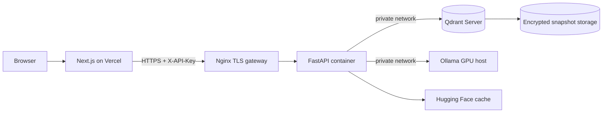

# Production architecture

## Request flow

1. The browser sends an authenticated request to the Next.js route.
2. Vercel calls only the public Nginx endpoint; the API key remains server-side.
3. Nginx terminates TLS, applies request limiting and forwards long-running requests.
4. FastAPI retrieves and reranks documents from Qdrant, then calls Ollama.
5. Qdrant and Ollama have no published ports and are reachable only on Docker's
   private network.

For high availability, run at least two FastAPI replicas behind a cloud load
balancer, move Qdrant to Qdrant Cloud or a replicated Qdrant cluster, and run
Ollama on a separately managed GPU pool. The single-host Compose file is a
production baseline, not a multi-zone HA design.
