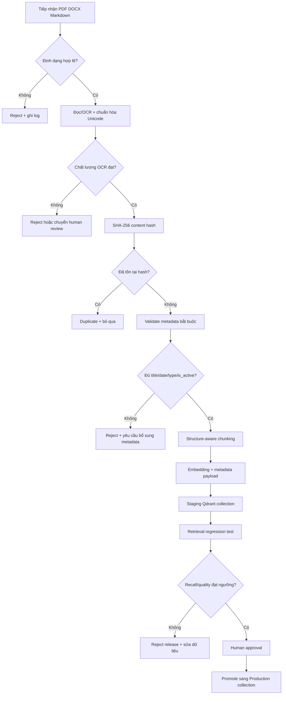

# Quy trình kiểm duyệt dữ liệu và lộ trình thực nghiệm RAG

## 1. Workflow Data Ingestion Guardrails

`backend/ingest_pipeline.py` chỉ tạo artifact staging và report, không ghi
Production Qdrant. Đây là chủ ý an toàn để việc promote là một bước có phê
duyệt và có thể audit.

## 2. Nguyên tắc kiểm duyệt

- Chỉ nhận `.pdf`, `.docx`, `.md`, `.markdown`; ảnh OCR cần được review riêng.
- Dùng SHA-256 trên file gốc để loại duplicate chính xác. Similarity/MinHash
  nên là bước phát hiện near-duplicate bổ sung, không thay thế review.
- Cảnh báo OCR gồm ký tự thay thế, mojibake và ký tự điều khiển. Tài liệu có
  cảnh báo được giữ ở trạng thái review, hoặc dùng `--reject-ocr-warnings` để
  fail closed.
- `effective_date` phải là `YYYY-MM-DD`; `is_active` phải là boolean.
- Chunking không cắt giữa Khoản/Điểm; payload giữ `source_sha256` và trạng thái
  `staged` để truy vết.

## 3. Lộ trình nghiên cứu 4 giai đoạn

| Giai đoạn | Mục tiêu | Thực hiện | Đầu ra/tiêu chí nghiệm thu |
|---|---|---|---|
| 1. Baseline Evaluation | Đo hiện trạng | Giữ `top_k=3`, `llama3.2:latest`, tắt reranker; chạy `evaluate_rag.py` trên `evaluation_dataset.json` | Baseline JSON/Markdown gồm Retrieval Recall, Faithfulness, Relevance, Citation Accuracy, Unsupported Claim Rate; cố định seed/cấu hình |
| 2. Retrieval Optimization | Tăng chất lượng truy xuất | Tăng initial retrieval lên 5–8; bật `RAG_RERANKER_MODEL`; dùng chunker bảo toàn Điều/Khoản; chuẩn hóa metadata; chạy lại cùng dataset | So sánh trước/sau, báo cáo Recall@k, MRR nếu có relevance labels, latency và tỷ lệ chunk hợp lệ |
| 3. LLM Benchmarking | Chọn model sinh phù hợp | Giữ cùng context/retrieval và test cases; chạy `llama3.2`, `llama3.1`, `mistral` và model bổ sung; đo quality, TTFT, TPS, memory | Ma trận model, raw JSON, review citation thủ công, quyết định model theo chất lượng–chi phí–latency |
| 4. Production & Monitoring | Chuẩn hóa vận hành | Qdrant Server/Cloud, Ollama GPU, `.env.local`/production secrets, backup/restore, logging latency, health check và alert | Runbook deploy, backup restore test, dashboard SLO, security checklist và collection promotion process |

### Kiểm soát tính khoa học

Mỗi giai đoạn dùng cùng bộ câu hỏi và ghi lại commit, model tag, embedding
model, chunk configuration, top-k, reranker, hardware và thời điểm chạy. Không
so sánh kết quả nếu thay đổi đồng thời nhiều biến mà không ghi nhận. Các chỉ số
LLM-as-a-judge cần kèm mẫu đánh giá thủ công để tránh kết luận chỉ từ proxy.

## 4. Ba ưu tiên làm ngay

1. Chạy ingestion guardrails trên toàn bộ `backend/data_documents`, sửa các
   tài liệu bị reject hoặc thiếu `effective_date`/`is_active`.
2. Tạo staging Qdrant collection và chạy retrieval regression trước khi
   promote; lưu report cùng commit/dataset version.
3. Hoàn thành baseline-vs-rerank với cùng dataset, sau đó review thủ công các
   câu có citation thấp hoặc unsupported claim cao.
